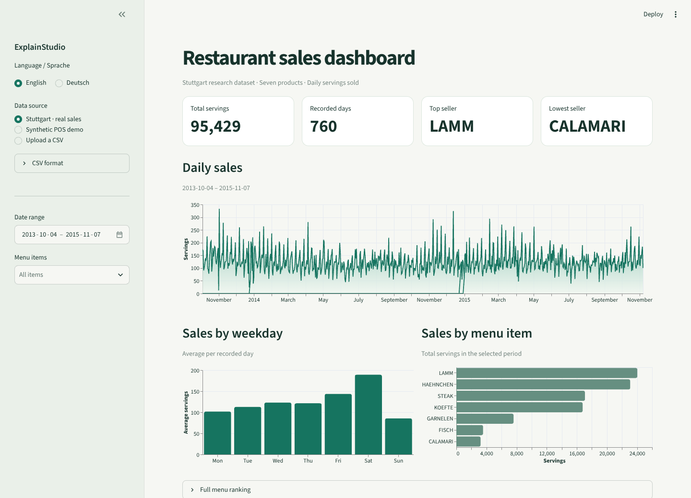

# ExplainStudio

A sales dashboard for small restaurants. Explore when demand is highest, which menu items sell most, and how those patterns change with the selected period. The app opens with real daily sales from Stuttgart. Choose the synthetic POS demo to try hourly sales and revenue, or upload your own CSV. The interface supports English and German.



## Run locally

Use Python 3.12.

```bash
python -m venv .venv
source .venv/bin/activate
python -m pip install -r requirements.txt
python -m streamlit run app.py
```

On Windows PowerShell, activate the environment with `.venv\Scripts\Activate.ps1` instead. Open the address printed by Streamlit.

```bash
python -m unittest discover -s tests -v
```

## POS upload format

Download the example CSV from the dashboard sidebar. Use UTF-8 and comma or semicolon separators. Each row represents a single sale line or an aggregated sales record.

| Column | Required | Format |
| --- | --- | --- |
| `date` | Yes | ISO date, such as `2025-01-18` |
| `dish` | Yes | Menu item name |
| `quantity` | Yes | Non-negative whole number |
| `hour` | Optional | Local hour, 0–23 |
| `unit_price` | Optional | EUR per unit, up to two decimal places. Semicolon CSVs can use a decimal comma. |
| `line_id` | Optional | Unique record ID. When supplied, repeated identical records with the same ID are removed and conflicting IDs are flagged. |

Rows without IDs can represent separate sales even when they have identical values. Blank required fields produce errors with line numbers. Hourly charts use rows with a recorded hour. The sales-value total appears when every selected row has a price. The weekday chart averages over days present in the dataset. A recorded day with no entries for a selected item counts as zero for that selection. Calendar dates absent from the dataset are separate from recorded zero-sales days. Uploads are processed in app memory. Use exports without names, contact details or payment information.

## Data attribution

**Fabian Taigel and Jan Meller (2020).** *Data for: Machine learning for inventory management: Analyzing two concepts to get from data to decisions*, Version 1, Mendeley Data. [Dataset and DOI](https://doi.org/10.17632/7s3ys9ntnz.1) · [CC BY 4.0](https://creativecommons.org/licenses/by/4.0/).

`data/stuttgart.csv` is the original `data_preprocessed.csv` with a local filename. Its contents are unchanged. ExplainStudio parses the source dates as month.day.year, validated against the weekday indicators, and reshapes the seven serving columns into one row per date and product. The dashboard covers October 2013 to November 2015, with 760 recorded days and 95,429 servings across the seven tracked products. The source also contains weather and lagged sales fields for later investigation.

`data/synthetic_pos.csv` contains fictional sales and prices. Regenerate it with `python generate_demo.py`.

## Implementation

The CSV loader normalizes records before the app passes them to an in-memory DuckDB connection. SQL produces daily totals, weekday averages, menu rankings, and hourly summaries. Streamlit and Altair render interactive charts and filters.

Phase 1 covers historical sales. Phase 2 will compare forecasts against a seasonal baseline using walk-forward backtesting.
